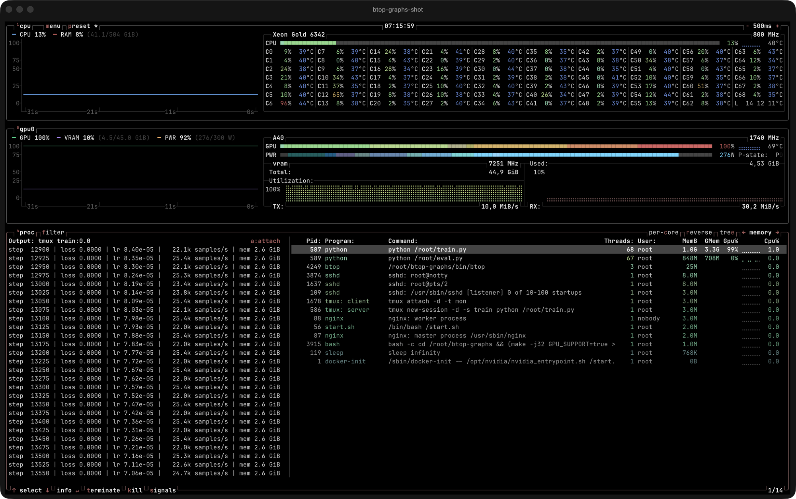

# btop-graphs

A terminal monitor for GPU training boxes: rented vast.ai or RunPod nodes, a home GPU over SSH, anything with an NVIDIA card.



## What it shows

- **Line charts with axes.** CPU and RAM, and GPU utilization, VRAM and power, as solid line charts with a 0–100 axis, a time axis that follows the tick rate, and a legend with live and raw values (`VRAM 10% (4.5/45.0 GiB)`, `PWR 92% (276/300 W)`).
- **GPU use per process.** `GMem` and `Gpu%` columns in the process list, read from NVML and summed across GPUs.
- **A process's output, live.** Select a process and its output opens in a column beside the list: the tmux pane it runs in, or the file its stdout is redirected to. When there is neither, it says why.
- **Attach.** `a` or Enter jumps to that process: inside tmux it switches to the pane, outside it runs `tmux attach` (or `less +F` for a log file) and comes back when you detach. Esc returns to the list.
- **`--llm <seconds>`.** Samples without a terminal and prints a short plain-text report (CPU, RAM, busiest cores, per-GPU utilization, VRAM and power with min/avg/max) for agents and scripts.

## Build

Linux with g++ 13 or newer:

```bash
make GPU_SUPPORT=true -j$(nproc)
./bin/btop
```

A layout for a training box, in `~/.config/btop/btop.conf`:

```
shown_boxes = "cpu gpu0 proc"
update_ms = 500
```

`line_charts = False` brings back braille graphs, and `proc_output = False` turns off the output column.

## Notes

- Under WSL2 the per-process GPU columns stay empty: the Windows driver can't map GPU work to Linux process IDs.
- Other users' processes (for example root's, when you're not root) show no output: their file descriptors aren't readable.

## License

Apache-2.0. Built on [btop++](https://github.com/aristocratos/btop) by Jakob P. Liljenberg (v1.4.4), which carries the same license; see [LICENSE](LICENSE). The charts, per-process GPU columns, output view, attach and `--llm` mode are new in this project.
